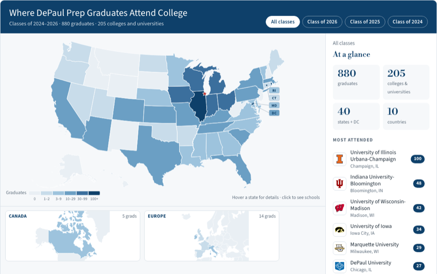
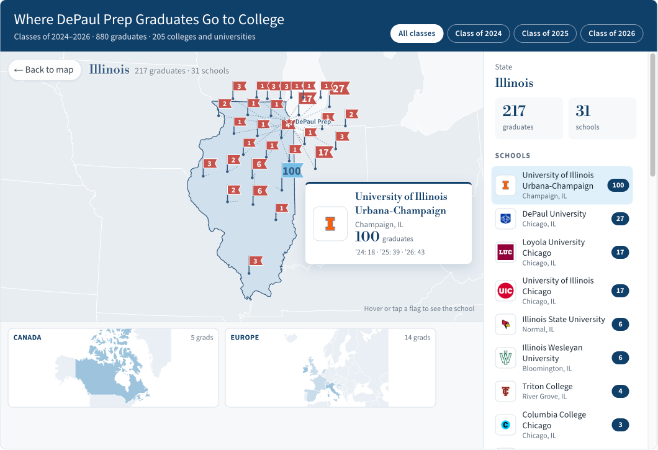

# DePaul College Prep · College Matriculation Map

An embeddable, interactive map of where DePaul College Prep graduates go to college.
It replaces the Google My Maps embed on the
[College Planning](https://www.depaulprep.org/academics/college-planning) page and is built to be
dropped into the school's current Finalsite site or its future Blackbaud site.

**Demo:** https://justro.github.io/dcp-college-map/ (a preview only; the school hosts the real
thing on its own site, see below)





## What it does

- A U.S. map shaded by how many graduates attend college in each state, with cutout insets for
  international regions (Canada, Europe, and any others that appear in the data).
- Hover a state or country to see its graduate count and the most-attended schools there.
- Click a state or country to zoom in. Every school gets a flag with its graduate count; hover or
  tap a flag to see the school's logo, location, and count by graduating class.
- Filter everything by graduating class ("Class of 2026") or show all classes together.
- Responsive from phone width up, keyboard accessible, and styled to the DePaul Prep brand
  (Navy `#0e406a`, Lake Blue `#5fb3e4`, Star Red `#bc312b`, Bodoni and Source Sans typefaces).

## Privacy

The matriculation report contains student names and IDs. **That file is never committed and never
published.** The build script reduces it to per-school counts before anything is written to the
`web/` folder, and it refuses to write output if any student name or ID slips through. See
[docs/refreshing-data.md](docs/refreshing-data.md#privacy).

## How the school hosts it

The deliverable is a single self-contained file. Upload `dist/dcp-college-map.bundle.js` (or
`dist/dcp-college-map.html` for an iframe) to the website's file manager and reference it from the
College Planning page. No GitHub account, build tooling, or third-party hosting is needed on the
school's side. Details in [docs/embedding.md](docs/embedding.md).

## Repository layout

```
dist/                   The deliverable: single-file builds to upload to the school's CMS
  dcp-college-map.bundle.js   Script embed (control + D3 + map shapes + data + logos + CSS)
  dcp-college-map.html        Same thing as a standalone page, for <iframe> embeds
web/                    The control as separate files (what the demo page runs; GitHub Pages serves this)
  index.html            Demo page: the control inside a stand-in school page
  embed.html            Bare page for <iframe> embedding
  dcp-college-map.js    The control (vanilla JS + D3)
  dcp-college-map.css   Styles, scoped under .dcpcm
  data/matriculation.json   Aggregated data (counts per school; no student data)
  logos/                School logos fetched by the build script
  vendor/               D3, topojson-client, and map topologies (no CDN dependency at runtime)
scripts/build_data.py   Turns the raw report into web/data/matriculation.json, then runs bundle.py
scripts/bundle.py       Packs web/ into the single files in dist/
data/
  raw/                  Drop the exported report here (git-ignored)
  overrides.json        Hand fixes: school aliases, coordinates, websites, logos
  geocode-cache.json    Locations resolved so far (committed so rebuilds are fast and offline)
  ipeds-institutions.csv  U.S. institution directory used to locate schools
docs/                   Documentation for the school's web team
```

## Documentation

- [How it works](docs/how-it-works.md): architecture, data format, customizing colors and text.
- [Refreshing the data](docs/refreshing-data.md): the yearly update, step by step.
- [Embedding](docs/embedding.md): uploading the file to the CMS and the script-tag and iframe snippets, with Finalsite and Blackbaud notes.

## Quick start (local preview)

```bash
cd web
python3 -m http.server 8000
# open http://localhost:8000/
```

No build step is needed to run the control from `web/`. The Python scripts are only used to refresh
the data and regenerate `dist/` (see the refresh doc).

## Credits

Map boundaries from the U.S. Census Bureau and Natural Earth via
[us-atlas](https://github.com/topojson/us-atlas) and [world-atlas](https://github.com/topojson/world-atlas).
School locations from [IPEDS](https://nces.ed.gov/ipeds/) and [OpenStreetMap](https://www.openstreetmap.org/copyright).
Built with [D3](https://d3js.org/).

## License

MIT. See [LICENSE](LICENSE). School logos remain the property of their respective institutions.
